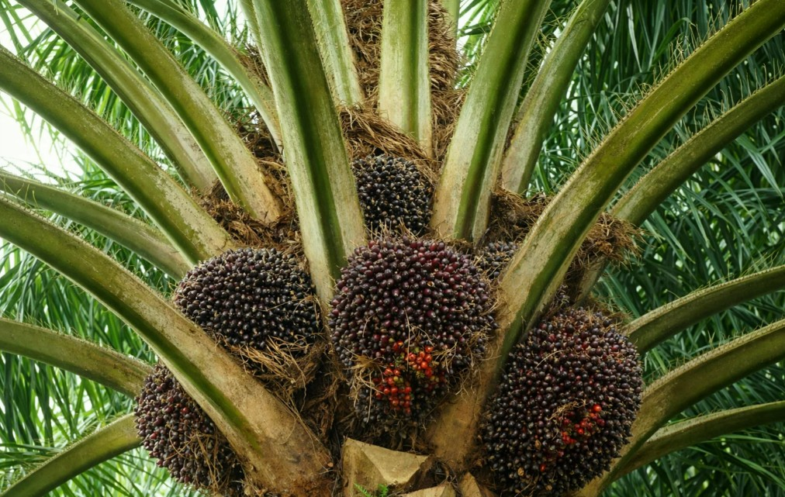

# Mengenal Lebih Dalam Tentang Kelapa Sawit: Apa Itu Pohon Kelapa Sawit & Karakternya?

**Pohon kelapa sawit merupakan tanaman perkebunan tropis dari genus Elaeis yang berperan sebagai sumber utama minyak nabati dunia. Dua spesies yang paling dikenal adalah Elaeis guineensis, yang berasal dari Afrika Barat, dan Elaeis oleifera, yang berasal dari kawasan Amerika Tengah dan Amerika Selatan. Dari kedua spesies tersebut, Elaeis guineensis menjadi spesies yang paling luas dibudidayakan secara komersial karena produktivitas minyaknya yang tinggi¹.**

*Kelapa sawit tumbuh optimal di wilayah tropis dengan curah hujan tinggi, suhu hangat sepanjang tahun, dan intensitas cahaya matahari yang cukup. Tanaman ini memiliki batang tegak dengan tinggi mencapai 20–30 meter, serta umur produktif rata-rata 25–30 tahun, menjadikannya salah satu komoditas perkebunan jangka panjang yang paling efisien².*

 

## Karakteristik Morfologi dan Fisiologi Pohon Kelapa Sawit
| Bagian Tumbuhan | Penjelasan |
| :---: | --- |
| Daun | Daun kelapa sawit merupakan daun majemuk menyirip dengan warna hijau tua, sedangkan pelepahnya berwarna hijau lebih muda. Secara morfologis, daun kelapa sawit menyerupai daun tanaman palma lainnya, seperti kelapa dan salak, namun dengan duri yang relatif lebih lunak. Daun berperan penting dalam proses fotosintesis yang mendukung pembentukan biomassa dan produksi minyak³. |
| Batang | Batang kelapa sawit bersifat tidak bercabang dan diselimuti bekas pelepah daun hingga tanaman berumur sekitar 12 tahun. Seiring pertambahan usia, pelepah yang mengering akan terlepas, sehingga permukaan batang tampak lebih bersih dan menyerupai batang kelapa. Struktur batang yang kokoh berfungsi menopang tajuk dan tandan buah yang berat⁴. |
| Akar | Kelapa sawit memiliki sistem akar serabut yang berkembang ke arah horizontal dan vertikal. Selain akar utama, terdapat pula akar adventif dan akar napas yang membantu penyerapan oksigen, terutama pada kondisi tanah dengan aerasi terbatas. Sistem perakaran ini memungkinkan kelapa sawit menyerap air dan unsur hara secara efisien⁵. |
| Bunga | Kelapa sawit bersifat monoecious, yaitu memiliki bunga jantan dan bunga betina yang terpisah dalam satu tanaman. Perbedaan waktu kematangan antara bunga jantan dan betina menyebabkan tingkat penyerbukan sendiri sangat rendah. Penyerbukan umumnya dibantu oleh serangga, khususnya Elaeidobius kamerunicus, yang berperan penting dalam meningkatkan produktivitas tandan buah segar⁶. |
| Buah | Buah kelapa sawit tersusun dalam bentuk tandan dan memiliki warna bervariasi, mulai dari hitam keunguan hingga merah terang, tergantung varietas dan tingkat kematangan. Struktur buah terdiri atas tiga lapisan utama: <ul><li>Eksokarp: kulit luar buah</li><li>Mesokarp: daging buah yang kaya minyak</li><li>Endokarp: cangkang keras pelindung inti Inti sawit (kernel)</ul> mengandung minyak inti sawit (palm kernel oil) yang memiliki karakteristik kimia berbeda dari minyak sawit mentah (crude palm oil/CPO) dan banyak dimanfaatkan dalam industri pangan serta oleokimia⁷. |

## Referensi

1. Corley, R.H.V. & Tinker, P.B. (2016). The Oil Palm. Wiley-Blackwell.
2. FAO (2021). Oil Palm Development and Sustainability.
3. Hartley, C.W.S. (1988). The Oil Palm. Longman Scientific & Technical.
4. Woittiez, L.S. et al. (2017). “Yield gaps in oil palm.” Field Crops Research, Elsevier.
5. Turner, P.D. & Gillbanks, R.A. (2003). Oil Palm Cultivation and Management.
6. Syed, R.A. et al. (1982). “Pollination of oil palm by insects.” Bulletin of Entomological Research.
7. Gunstone, F.D. (2011). Vegetable Oils in Food Technology. Wiley-Blackwell.

## Link ke Artikel Asli
[Klik Link Disini](https://gapki.id/id/wikisawit/knowledge-base/mengenal-lebih-dalam-tentang-kelapa-sawit-apa-itu-pohon-kelapa-sawit-karakternya/)
